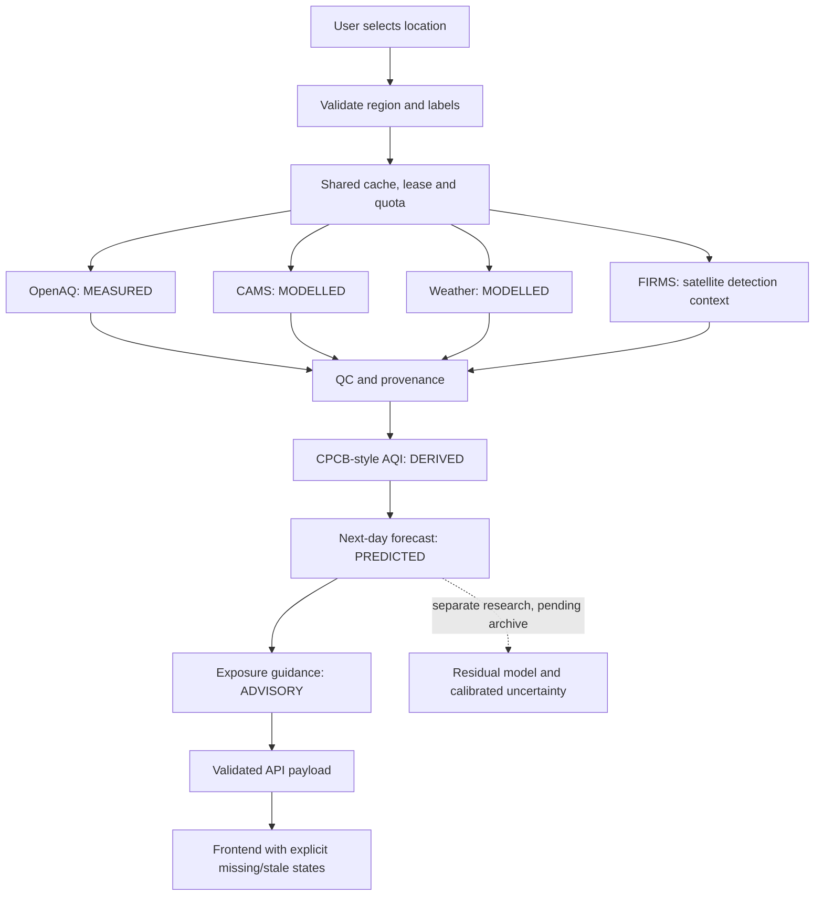

# Architecture defense

The live and research paths have distinct evidence requirements. The live UI currently issues a modelled CAMS-based nationwide estimate; the station correction remains experimental.

| Value | Classification | Meaning |
| --- | --- | --- |
| Station pollutant concentration | MEASURED | Instrument/provider observation, subject to QC |
| CAMS pollutant field | MODELLED | Atmospheric forecast at grid scale |
| Weather forecast | MODELLED | Future weather estimate, not observed outcome |
| AQI/sub-index/category | DERIVED | Index arithmetic under AirGuard’s convention |
| Tomorrow’s index | PREDICTED | Forecast transformation or a future validated correction |
| Activity guidance | ADVISORY | Exposure guidance, not diagnosis or individual disease risk |

Cache values expire against source-age and IST boundaries. Missing measured support permits labelled modelled fallback, not a synthetic station observation. If all forecast data fail, prediction is withheld. Experimental model artifacts never automatically replace the production forecast.

Evidence checkpoint: measured dataset `4761a5da60dde059b1c7bbfc5403e32d26c983f80e3fc22683eba8a13119821d`; preliminary run `287c87db04a6b29459374c4d50637f943c04dfe10d9072d7e296b74ad1d45a3f`; protocol `e24b664747029a7611efcf4fb19b8cfdf8b12762d379927698fa6e98777d67e8`. Primary CAMS development/final/prospective performance must never be inferred from this non-CAMS run. See [claim ledger](CLAIM_EVIDENCE_MATRIX.md) and [results sheet](ONE_PAGE_RESULTS.md).
